<!-- Original editorial composition for Samuel Aulotte. Asset sources and font licenses: ASSETS.md. -->
<picture>
  <source media="(max-width: 900px) and (prefers-color-scheme: dark)" srcset="profile-cards/hero-dark-mobile.svg">
  <source media="(max-width: 900px)" srcset="profile-cards/hero-light-mobile.svg">
  <source media="(prefers-color-scheme: dark)" srcset="profile-cards/hero-dark.svg">
  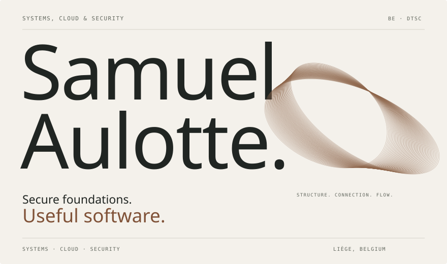
</picture>

  <a href="https://samuel-aulotte-portfolio.dt-services-1346.chatgpt.site"><strong>Explore my portfolio ↗</strong></a> &nbsp; / &nbsp;
  <a href="https://samuel-aulotte-portfolio.dt-services-1346.chatgpt.site/documents/cv-samuel-aulotte.pdf">CV</a> &nbsp; / &nbsp;
  <a href="https://www.linkedin.com/in/samuel-aulotte/">LinkedIn</a> &nbsp; / &nbsp;
  <a href="mailto:samuel.aulotte@dtsc.be">Email</a>

I connect secure infrastructure with useful software. Systems, cloud and security at **DT Services & Consulting**, with end-to-end application development, automation and support for secure AI R&D environments.

<picture>
  <source media="(max-width: 900px) and (prefers-color-scheme: dark)" srcset="profile-cards/practice-dark-mobile.svg">
  <source media="(max-width: 900px)" srcset="profile-cards/practice-light-mobile.svg">
  <source media="(prefers-color-scheme: dark)" srcset="profile-cards/practice-dark.svg">
  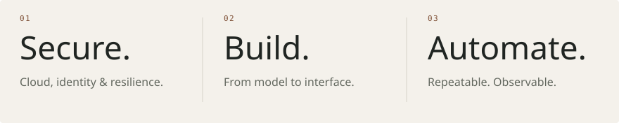
</picture>

## Selected work

<a href="#user-content-warevia"><picture>
  <source media="(max-width: 900px)" srcset="profile-cards/work-warevia-mobile.svg">
  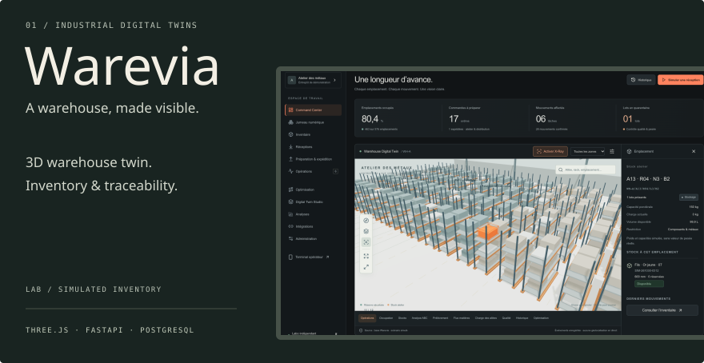
</picture></a>

<a href="#user-content-humapace">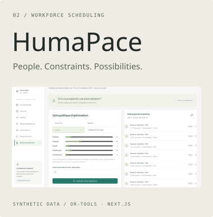</a> <a href="#user-content-uas">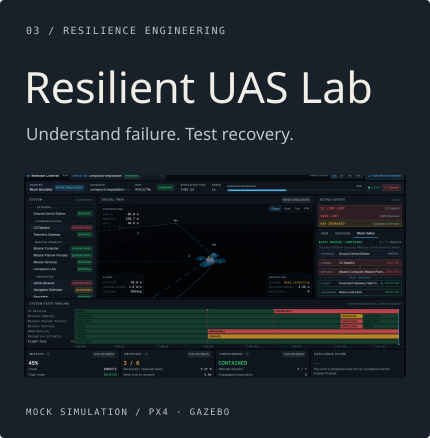</a>

<a href="#user-content-warevia">Warevia</a> &nbsp; / &nbsp; <a href="#user-content-humapace">HumaPace</a> &nbsp; / &nbsp; <a href="#user-content-uas">Resilient UAS Lab</a>

Personal labs and portfolio demonstrations. Synthetic or simulated data; project context below.

<strong>Conductor</strong> — Finite-capacity planning

Odoo-connected planning with OR-Tools CP-SAT, versioned scenarios and human approval.

Python · FastAPI · Next.js · PostgreSQL · OR-Tools · Odoo

<a href="project-images/conductor-demo.png">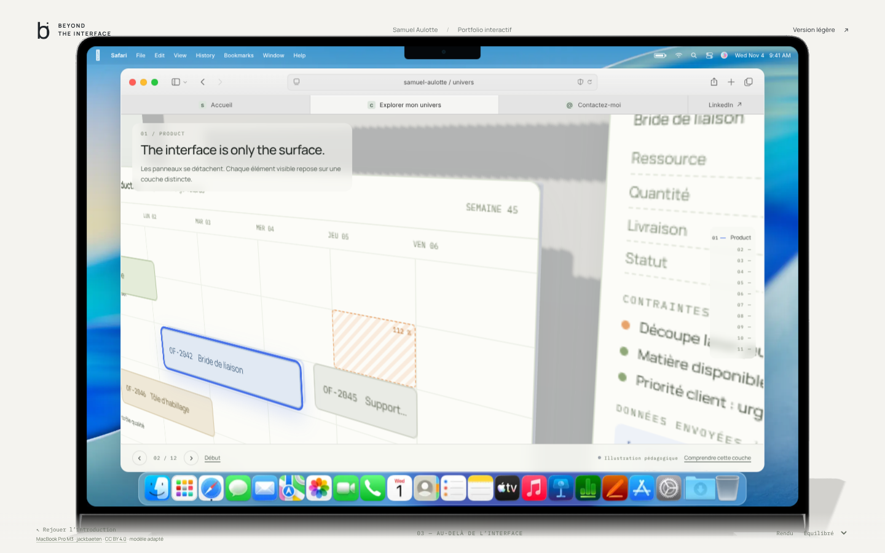</a>

<em>Conductor — pedagogical portfolio demonstration with synthetic data.</em>

<strong>OPERIS & Warevia</strong> — Industrial digital twins

3D production and warehouse twins, isolated MES simulation, transactional inventory and traceability.

Three.js · React Three Fiber · FastAPI · PostgreSQL · Docker

<a href="project-images/warevia.png">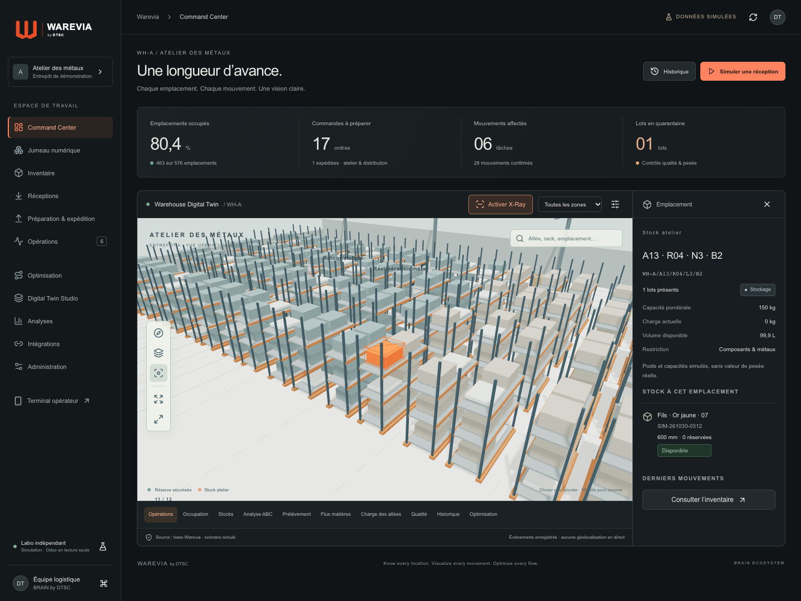</a>

<em>Warevia — warehouse laboratory, simulated inventory.</em>

<a href="project-images/warevia-anatomy.png">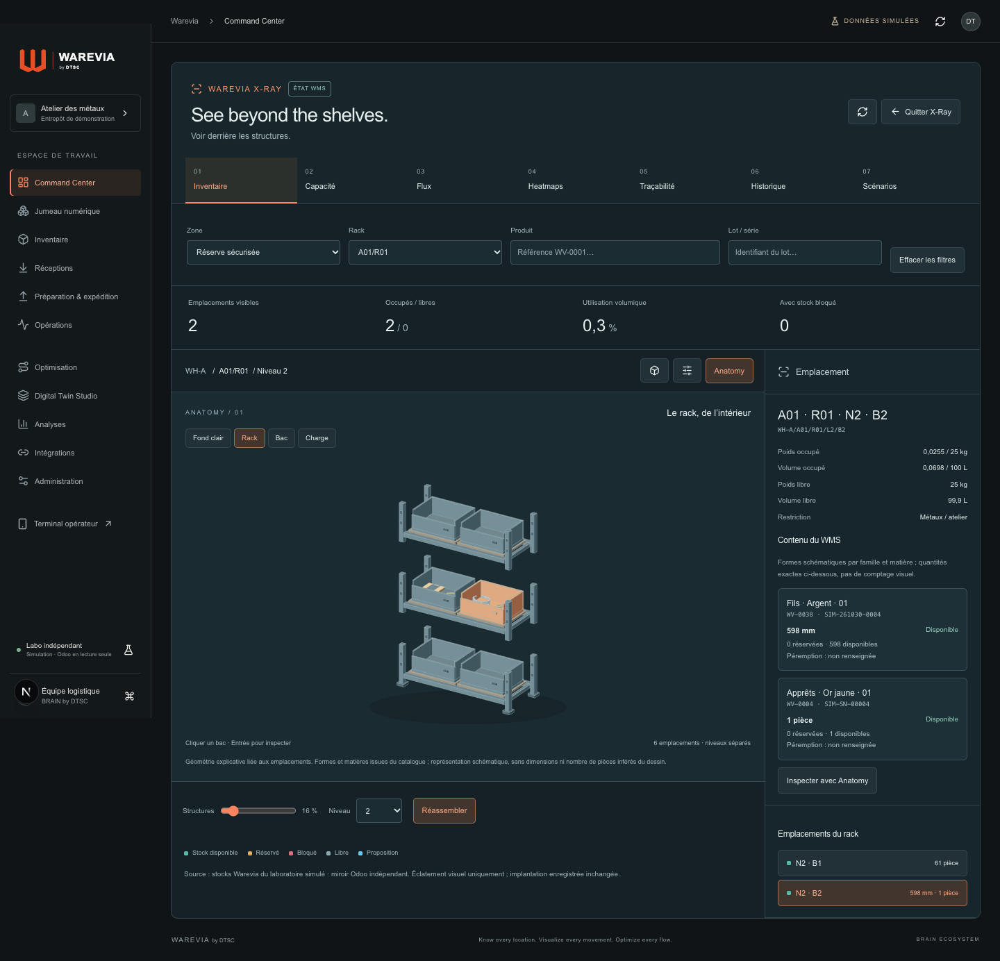</a>

<strong>HumaPace</strong> — Workforce scheduling

Qualifications, availability, replacements and travel constraints, with human-approved scenarios.

Python · OR-Tools · FastAPI · Next.js · PostgreSQL · Leaflet

<a href="project-images/humapace.png">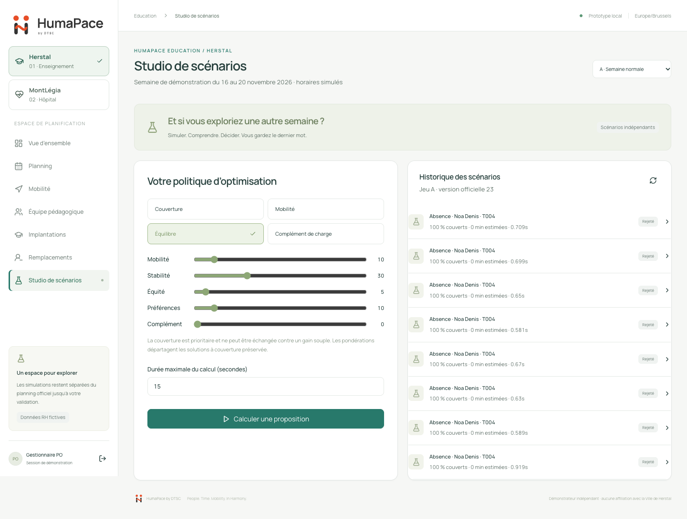</a>

<em>HumaPace — scenario studio, synthetic education datasets.</em>

<strong>Resilient UAS Lab</strong> — Resilience under failure

Fault injection, telemetry, replay and recovery and containment reports for autonomous-system simulations.

Python · FastAPI · Next.js · Docker · PX4/Gazebo

<a href="project-images/uas.png">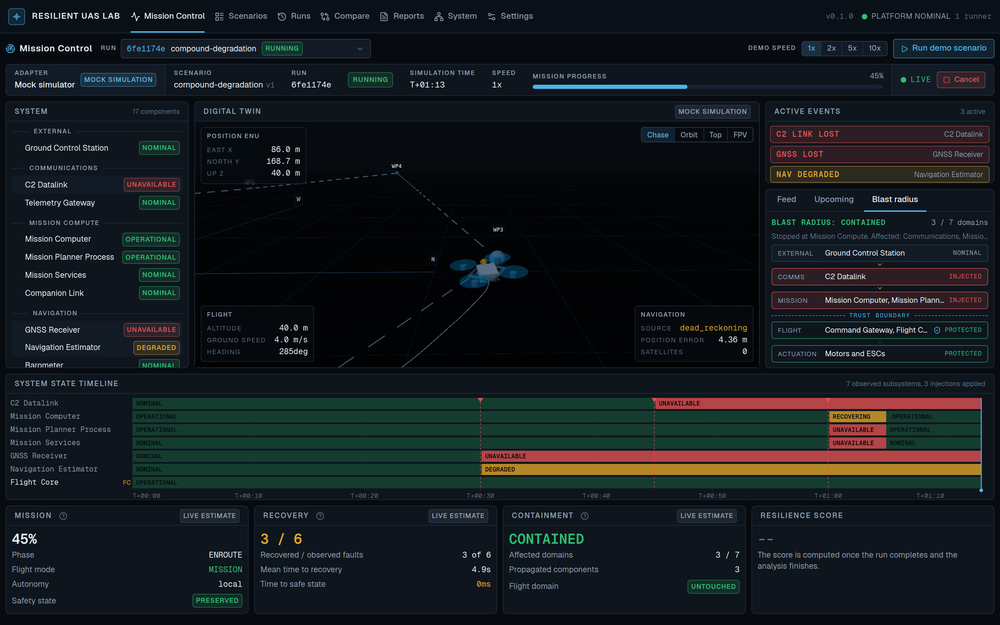</a>

<em>Resilient UAS Lab — mock simulation, mission control.</em>

<strong>Observability & automation lab</strong> — Repeatable infrastructure

Documented Ansible, Grafana Alloy and Mimir deployments, system metrics, remote write and troubleshooting.

Ansible · Grafana · Alloy · Mimir

## Tools & practices

**Infrastructure & security** · Linux, Windows Server, Azure, Microsoft 365, Entra ID, network segmentation.  
**Software & automation** · Python, PowerShell, TypeScript, React, Next.js, FastAPI, PostgreSQL, Ansible, Docker.  
**AI & observability** · Secure R&D environments, reproducibility, access controls, Grafana, Alloy and Mimir.

<strong>Explore the full toolkit</strong> — technologies, practices & experience

<h3> Cybersecurity &amp; identity</h3>

<code>Zero Trust</code> · <code>IAM</code> · <code>MFA</code> · <code>RBAC</code> · <code>Conditional Access</code> · <code>OSINT</code>

See practices &amp; experience

<ul>
<li>Cybersecurity audits, vulnerability analysis, risk identification and Windows/Linux hardening; security-by-design approaches.</li>
<li>Microsoft Entra ID and Microsoft 365 security: identity protection, access policies and least privilege.</li>
<li>Security documentation, IT/security charter, OSINT and audit support within LUCID; backup, resilience and business continuity.</li>
</ul>

<h3> Networks &amp; connectivity</h3>

<code>VLAN</code> · <code>VPN</code> · <code>RADIUS</code> · <code>Firewalling</code>

See practices &amp; experience

<ul>
<li>Network segmentation and Zero Trust architectures, firewalls and network security.</li>
<li>Infrastructure architecture, secure connectivity and network services.</li>
</ul>

<h3> Systems &amp; virtualization</h3>

<code>Active Directory</code> · <code>DNS</code> · <code>DHCP</code> · <code>Group Policy</code>

See practices &amp; experience

<ul>
<li>Windows and Linux environments, systems administration, virtualization and infrastructure monitoring.</li>
<li>Active Directory services, DNS, DHCP and Group Policy; interest in Proxmox and infrastructure architecture.</li>
</ul>

<h3> Cloud &amp; Microsoft</h3>

<code>Entra ID</code>

See practices &amp; experience

<ul>
<li>Secure cloud design, cloud services and on-premises infrastructure security.</li>
<li>Secured Microsoft 365, Azure and Entra ID; contributed to monitoring with Defender, Sentinel and Azure Monitor.</li>

</ul>

<h3> DevOps, containers &amp; automation</h3>

<code>Docker Compose</code> · <code>Terraform fundamentals</code>

See practices &amp; experience

<ul>
<li>Building and operating Docker-based environments; containerized applications, reverse proxies and secure application deployment.</li>
<li>Infrastructure automation, Infrastructure as Code, secure CI/CD support, versioning, pipelines and technical documentation. Terraform: fundamentals.</li>
<li>Workflow automation and API-driven architectures; repeatable deployments and troubleshooting.</li>
</ul>

<h3> Software, scripting &amp; web</h3>

<code>REST APIs</code> · <code>OR-Tools</code>

See practices &amp; experience

<ul>
<li>End-to-end application development: requirements, architecture, implementation, testing and technical documentation.</li>
<li>Modern web platforms, Dockerized web deployments, web infrastructure and hosting; webmaster work and technical coordination of web projects.</li>
<li>Enterprise integrations including Odoo, business applications and optimisation.</li>
</ul>

<h3> AI environments &amp; R&amp;D support</h3>

<code>MLOps</code> · <code>LLM integration</code> · <code>AI governance</code> · <code>Audit logging</code> · <code>Reproducibility</code>

See practices &amp; experience

<ul>
<li>AI-assisted business applications, practical AI integration and local/cloud AI experimentation; AI governance and security.</li>
<li>At BRAIN by DTSC: support for versioning, pipelines, reproducibility and documentation for AI R&amp;D; access controls, RBAC, audit logging, encryption and GDPR-by-design practices.</li>
<li>Helped structure research topics around causal AI, graphs, reinforcement learning, simulation and MLOps.</li>
<li>Productivity and design tools: Notion, Figma and Canva. Ongoing technology watch across cybersecurity, AI and the wider tech ecosystem.</li>
</ul>

<h3> Observability &amp; resilience</h3>

<code>Alloy</code> · <code>Mimir</code> · <code>Telemetry</code> · <code>PX4/Gazebo</code>

See practices &amp; experience

<ul>
<li>Observability &amp; automation lab: documented Ansible deployment of Grafana Alloy and a local Grafana/Mimir stack, system metrics, remote write, service configuration and troubleshooting.</li>
<li>Resilient UAS Lab: declarative fault scenarios, telemetry, recovery and containment metrics, replay and comparison reports for autonomous-system simulations.</li>
<li>Python/FastAPI, Next.js, Docker and PX4/Gazebo; segmented services, hardened containers and security checks in GitHub Actions. Published simulation reports.</li>
</ul>

<strong>Current interests</strong> — what I keep exploring

Where my curiosity goes. Personal interests, not proficiency scores.

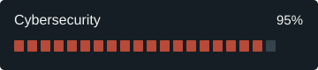
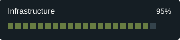
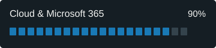
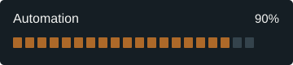
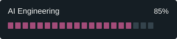
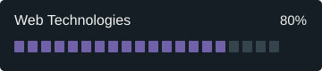

## Experience & credentials

<strong>Cybersecurity audit &amp; secure cloud architecture</strong> · ongoing

Major French jewellery house (confidential client, NDA). Conducted a cybersecurity audit, designed secure cloud solutions and contributed to on-premises infrastructure security.

<strong>Cybersecurity &amp; Infrastructure Administrator</strong> · DTSC · 2025–present

Microsoft cloud and identity security; monitoring, hardening, vulnerability analysis, secure CI/CD, infrastructure administration and security documentation.

<strong>DevSecOps, MLOps &amp; AI Security Support</strong> · BRAIN by DTSC · 2025–present

Reproducible AI R&amp;D environments, versioning and pipelines, access controls, audit logging, encryption and GDPR-by-design practices.

<a href="https://www.credly.com/badges/484a67ca-3bf4-4104-98ee-7201c8e2186c/linked_in_profile">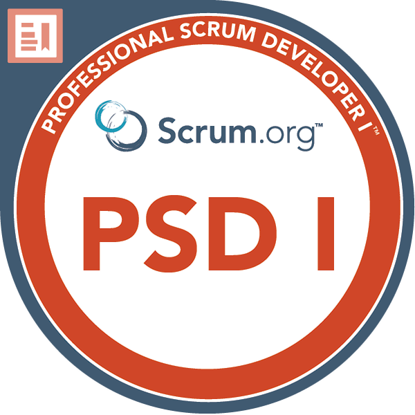</a>
<strong><a href="https://www.credly.com/badges/484a67ca-3bf4-4104-98ee-7201c8e2186c/linked_in_profile">Professional Scrum Developer I</a></strong> 
Scrum.org · November 2026

 

<strong>Training & languages</strong>

<ul>
<li><strong>Google · 2025:</strong> Cybersecurity Professional Training; Networks and Network Security.</li>
<li><strong>Cisco · 2024:</strong> Networking Basics, Operating Systems Basics, Introduction to IoT.</li>
<li><strong>French:</strong> native · <strong>English:</strong> C2 certified (2025).</li>
</ul>

<strong>Inside the workshop</strong> — an illustrated look at my engineering world

<picture>
  <source media="(prefers-reduced-motion: reduce) and (prefers-color-scheme: dark)" srcset="workshop-v2-dark.svg">
  <source media="(prefers-reduced-motion: reduce)" srcset="workshop-v2-light.svg">
  <source media="(prefers-color-scheme: dark)" srcset="workshop-v2-dark.gif">
  <source media="(prefers-color-scheme: light)" srcset="workshop-v2-light.gif">
  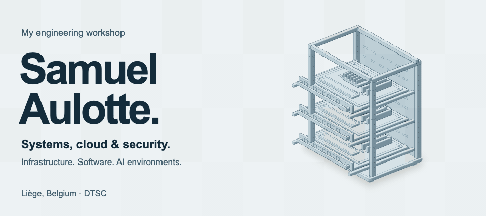
</picture>

---

### Let’s build something useful.

[Portfolio ↗](https://samuel-aulotte-portfolio.dt-services-1346.chatgpt.site) · [LinkedIn](https://www.linkedin.com/in/samuel-aulotte/) · [samuel.aulotte@dtsc.be](mailto:samuel.aulotte@dtsc.be) · [DTSC on GitHub](https://github.com/DT-Service-Consulting)

Liège, Belgium · Open to hybrid work
